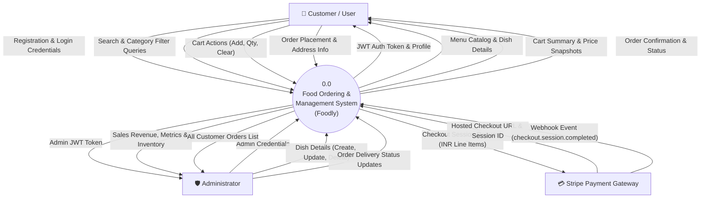
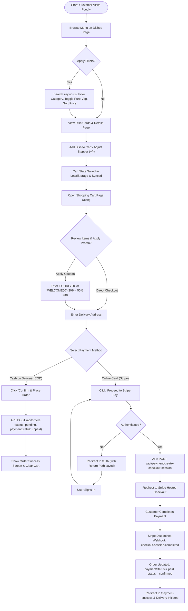
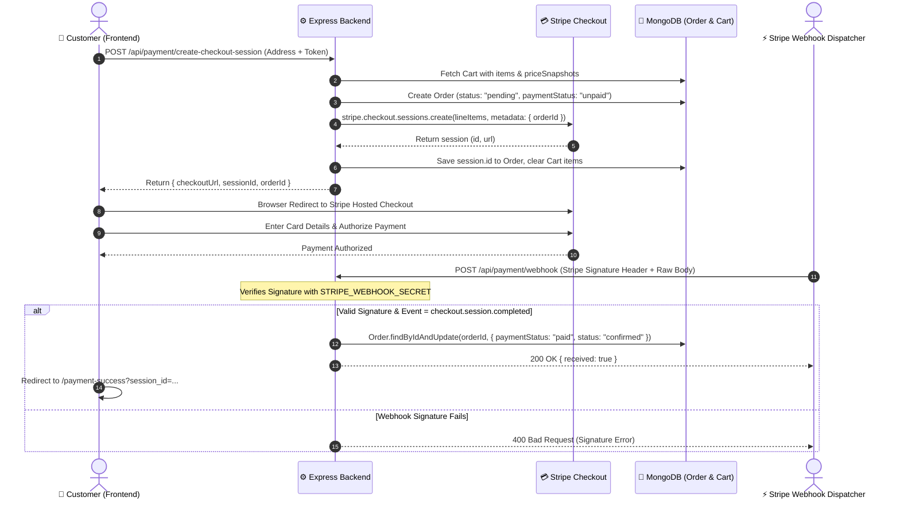
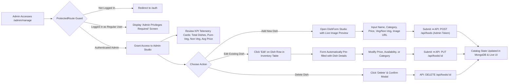

# 🍲 Foodly — Full-Stack Food Ordering Platform & REST API

A modern, production-grade full-stack food delivery application built with **React 18**, **Vite**, **Node.js**, **Express 5**, **MongoDB**, and **Stripe Payment Gateway**.

---

## 🌟 Key Features

### 🎨 Frontend (Client App)
* **Modern & Appetizing UI**: Glassmorphic sticky navigation, vibrant foodie color palette, fluid micro-interactions, and mobile-responsive drawer.
* **Full Authentication & User System**:
  * Complete **Sign In** and **Sign Up** portal (`/auth`) connected to backend endpoints.
  * Stateless session management via JWT tokens stored in `localStorage`.
  * Topbar user profile pill showing avatar initials, role indicator, and sign-out dropdown.
  * One-click demo credential autofill for rapid testing.
* **Protected Routes & Role Security**:
  * **ProtectedRoute** guard wrapping administrative pages (`/admin/manage`, `/add-dish`).
  * Automatic redirect to `/auth` with return path tracking if unauthenticated.
  * Access denied screen if an authenticated user lacks the `admin` role.
* **Interactive Food Discovery**:
  * Real-time search by dish name, ingredients, or keywords.
  * Category filter pills (*Main Course, Breakfast, Snacks, Desserts, Beverages*).
  * **Pure Veg Only** toggle switch with standard culinary indicators (🟢 Veg / 🔴 Non-Veg).
  * Dynamic price sorting (*Recommended, Low to High, High to Low*).
* **Smart Cart System**:
  * Seamless cart synchronization with persistent state (`localStorage`).
  * Live **Cart Pill Badge** in header displaying active item count and subtotal.
  * Direct card-level quantity steppers (`- 1 +`).
  * Promo discount vouchers (e.g., `FOODLY20`, `WELCOME50`).
  * Delivery address input and payment mode toggle (Cash on Delivery / Stripe Online Pay).
* **Single Dish Showcase**: Detailed page with nutritional tags, chef picks, preparation time, and quantity selector.
* **Admin Management Studio**:
  * Real-time KPI metric cards (*Total Dishes, Veg, Non-Veg, Average Price*).
  * Live inventory table with instant search, edit, and deletion capabilities.
  * Add & Edit dish form featuring **live image URL preview**.
* **Instant Toast Notifications**: Feedback alerts for cart updates, order placements, and menu edits.

### ⚙️ Backend (REST API)
* **Modular Architecture**: Layered MVC structure (Controllers, Models, Routes, Middleware, Config).
* **Authentication & RBAC**:
  * Stateless **JWT (JSON Web Token)** authentication.
  * Secure password hashing using **BcryptJS**.
  * Role-Based Access Control (**User** vs **Admin**).
* **Cart Price Snapshot Strategy**: Stores price snapshots upon cart entry to protect order integrity against menu price fluctuations.
* **Stripe Payment Integration**:
  * Stripe Checkout Session creation for online payments.
  * Secure Stripe Webhook listener using raw request buffer to verify payment signatures and auto-confirm orders.
* **Admin Intelligence**: Aggregated statistics dashboard calculating total revenue, registered users, order statuses, and catalog volume.

---

## 🏗️ Project Architecture

```
Food_Order_API/
├── Backend/
│   ├── config/             # MongoDB database connection
│   │   └── db.js
│   ├── controllers/        # Business logic controllers
│   │   ├── adminController.js
│   │   ├── cartController.js
│   │   ├── foodController.js
│   │   ├── orderController.js
│   │   ├── paymentController.js
│   │   └── userController.js
│   ├── middleware/         # Auth & Role verification
│   │   ├── adminAuth.js
│   │   └── auth.js
│   ├── models/             # Mongoose schemas
│   │   ├── cart.js
│   │   ├── food.js
│   │   ├── order.js
│   │   └── user.js
│   ├── routes/             # Express API endpoints
│   │   ├── adminRoutes.js
│   │   ├── cartRoutes.js
│   │   ├── foodRoutes.js
│   │   ├── orderRoutes.js
│   │   ├── paymentRoutes.js
│   │   └── userRoutes.js
│   ├── scripts/            # CLI test and seed scripts
│   │   ├── seedAdmin.js
│   │   ├── testApi.js
│   │   └── testPayment.js
│   ├── .env.example        # Environment variables template
│   ├── package.json
│   └── server.js           # Server entry point
│
├── Frontend/
│   ├── src/
│   │   ├── components/     # Reusable UI components
│   │   │   ├── AppShell.jsx
│   │   │   ├── CartSummary.jsx
│   │   │   ├── DishForm.jsx
│   │   │   ├── DishTable.jsx
│   │   │   ├── FoodCard.jsx
│   │   │   ├── Icons.jsx
│   │   │   ├── ProtectedRoute.jsx   # Route security guard
│   │   │   └── SectionHeading.jsx
│   │   ├── context/        # React Context stores
│   │   │   ├── AuthContext.jsx      # Live JWT & user store
│   │   │   ├── CartContext.jsx      # Shopping cart store
│   │   │   └── DishesContext.jsx    # Catalog store
│   │   ├── pages/          # Application views
│   │   │   ├── AddDishPage.jsx
│   │   │   ├── AdminManagePage.jsx
│   │   │   ├── AuthPage.jsx         # Sign in / Sign up page
│   │   │   ├── CartPage.jsx
│   │   │   ├── DishDetailsPage.jsx
│   │   │   ├── DishesPage.jsx
│   │   │   └── Hero.jsx
│   │   ├── styles/         # Modern design system
│   │   │   └── global.css
│   │   ├── App.jsx
│   │   ├── data.js         # Default dishes data
│   │   └── main.jsx
│   ├── package.json
│   └── vite.config.js      # Reverse proxy to backend (port 5000)
└── README.md
```

---

## 📊 Data Flow Diagrams (DFD)

### 1. Level 0 DFD (Context Diagram)
The Context Diagram establishes the boundary of the Food Ordering System, mapping all primary interactions between external entities (*Customers, Administrators, Stripe Payment Gateway*) and the central system.



---

### 2. Level 1 DFD (Decomposed System Processes & Data Stores)
The Level 1 DFD decomposes the system into six modular sub-processes, identifying data interactions across MongoDB collections (*D1 Users, D2 Foods, D3 Carts, D4 Orders*).

```mermaid
flowchart TD
    subgraph Entities ["External Entities"]
        Customer["👤 Customer"]
        Admin["🛡️ Admin"]
        Stripe["💳 Stripe API"]
    end

    subgraph Processes ["Core System Processes"]
        P1["1.0 User Authentication & RBAC"]
        P2["2.0 Menu Catalog & Discovery"]
        P3["3.0 Cart Management & Price Snapshot"]
        P4["4.0 Order Lifecycle & Placement"]
        P5["5.0 Payment Gateway & Webhooks"]
        P6["6.0 Admin Dashboard & Analytics"]
    end

    subgraph DataStores ["Data Stores (MongoDB Collections)"]
        D1[("D1: Users Collection")]
        D2[("D2: Foods Collection")]
        D3[("D3: Carts Collection")]
        D4[("D4: Orders Collection")]
    end

    %% Process 1: Auth
    Customer -->|"Credentials (email, password)"| P1
    Admin -->|"Admin Login"| P1
    P1 <-->|"Validate & Fetch Hash"| D1
    P1 -->|"JWT Token & User Session"| Customer
    P1 -->|"Admin JWT Token"| Admin

    %% Process 2: Menu
    Customer -->|"Browse, Search & Filter"| P2
    P2 <-->|"Fetch Available Dishes"| D2
    P2 -->|"Filtered Menu Results"| Customer

    %% Process 3: Cart
    Customer -->|"Add / Update Item (+ Bearer Token)"| P3
    P3 <-->|"Fetch Live Price"| D2
    P3 <-->|"Store Cart & Price Snapshot"| D3
    P3 -->|"Live Cart Data & Totals"| Customer

    %% Process 4: Orders
    Customer -->|"Place Order (COD / Address)"| P4
    P4 <-->|"Read Cart Items"| D3
    P4 -->|"Create Order Record & Clear Cart"| D4
    P4 -->|"Order Status & ID"| Customer

    %% Process 5: Payments
    Customer -->|"Initiate Online Payment"| P5
    P5 <-->|"Get Cart Total & Snapshot"| D3
    P5 -->|"Create Pending Order"| D4
    P5 -->|"Create Session"| Stripe
    Stripe -->|"Checkout URL"| P5
    P5 -->|"Redirect to Stripe"| Customer
    Stripe -->|"Webhook: Session Paid"| P5
    P5 -->|"Update Status: Paid & Confirmed"| D4

    %% Process 6: Admin Operations
    Admin -->|"CRUD Dish Operations"| P6
    P6 <-->|"Add/Edit/Delete Food"| D2
    Admin -->|"Update Order Status"| P6
    P6 <-->|"Update Status / Read All"| D4
    P6 <-->|"Count Users & Aggregate Revenue"| D1
    P6 -->|"Metrics, Revenue & Orders"| Admin
```



---

## 🔄 Core System Workflows

### 1. Customer Ordering & Checkout Workflow
End-to-end journey of a customer from discovering delicacies to placing an order.



---

### 2. Stripe Payment & Webhook Lifecycle
Sequence diagram detailing the secure raw-buffer webhook verification and asynchronous payment reconciliation.



---

### 3. Administrator Operations & Catalog Workflow
Workflow representing role-based authorization guards, dashboard telemetry, and menu management.



---

## 💻 Tech Stack

| Domain | Technologies |
|---|---|
| **Frontend** | React 18, Vite 5, React Router v7, Context API, Modern CSS3 |
| **Backend** | Node.js, Express v5.2, MongoDB, Mongoose v9.3 |
| **Security & Auth** | JSON Web Tokens (`jsonwebtoken`), BcryptJS (`bcryptjs`) |
| **Payments** | Stripe API (`stripe` v22.0) |
| **Tooling & Dev** | Nodemon, Dotenv, UUID |

---

## 🔐 Environment Variables Setup

> **Note**: Sensitive credentials are never committed to version control. Set up your local environment file using the template below.

Navigate to the `Backend` directory and create a `.env` file based on `.env.example`:

```bash
cd Backend
cp .env.example .env
```

### Required Variables (`Backend/.env`)

```env
# Server Port (matches Vite reverse proxy target)
PORT=5000

# MongoDB Connection String (Atlas URI or local MongoDB instance)
MONGO_URI=mongodb+srv://<username>:<password>@cluster0.mongodb.net/food_order_db?retryWrites=true&w=majority

# Secret key for JWT signing & verification (generate a strong random string)
JWT_SECRET=your_jwt_secret_key_here

# Stripe Payment Gateway Credentials (from Stripe Dashboard in Test Mode)
STRIPE_SECRET_KEY=sk_test_yourStripeSecretKeyHere
STRIPE_WEBHOOK_SECRET=whsec_yourStripeWebhookSecretHere

# Frontend URL (for Stripe redirect callbacks)
CLIENT_URL=http://localhost:5173
```

---

## 🚀 Getting Started

### 1. Prerequisites
* **Node.js** (v18 or higher recommended)
* **npm** or **pnpm**
* **MongoDB** (local daemon or free MongoDB Atlas cloud cluster)

---

### 2. Backend Setup & Run

1. Open your terminal and navigate to the backend folder:
   ```bash
   cd Backend
   ```
2. Install dependencies:
   ```bash
   npm install
   ```
3. Configure your `.env` file as shown in the [Environment Variables](#-environment-variables-setup) section.
4. Seed the initial admin account (`admin@test.com` / `admin123`):
   ```bash
   node scripts/seedAdmin.js
   ```
5. Start the backend development server:
   ```bash
   npm run dev
   ```
   The API server will run at: `http://localhost:5000`

---

### 3. Frontend Setup & Run

1. Open a new terminal tab and navigate to the frontend folder:
   ```bash
   cd Frontend
   ```
2. Install dependencies:
   ```bash
   npm install
   ```
3. Start the Vite development server:
   ```bash
   npm run dev
   ```
4. Open your browser and navigate to:
   ```
   http://localhost:5173
   ```
   *Vite automatically forwards all `/api/*` requests to the backend server running on `http://localhost:5000`.*

---

## 🛡️ Protected Authentication & Role Access

* **Public Routes**:
  * `/` (Hero & Highlights)
  * `/dishes` (Catalog with search & filters)
  * `/dish/:id` (Dish Details)
  * `/cart` (Cart summary & preparation)
  * `/auth` (Sign in & registration portal)
* **Protected Admin Routes**:
  * `/admin/manage` (Catalog inventory & metrics)
  * `/add-dish` (New dish creation studio)

### Seeded Test Credentials:
| Account Type | Email | Password | Role |
|---|---|---|---|
| **Admin** | `admin@test.com` | `admin123` | `admin` (Full dashboard access) |
| **User** | Register via `/auth` | Any valid pass | `user` (Browsing & ordering) |

---

## 📡 API Reference Matrix

### 👤 User & Authentication (`/api/users`)
| Method | Endpoint | Access | Description |
|---|---|---|---|
| `POST` | `/api/users/register` | Public | Register a new user account |
| `POST` | `/api/users/login` | Public | Authenticate user and receive JWT token |

---

### 🍛 Food Catalog (`/api/foods`)
| Method | Endpoint | Access | Description |
|---|---|---|---|
| `GET` | `/api/foods` | Public | Fetch food menu (`?category=...&available=true`) |
| `POST` | `/api/foods` | Admin | Create a new food item |
| `PUT` | `/api/foods/:id` | Admin | Update existing food details |
| `DELETE` | `/api/foods/:id` | Admin | Delete a food item by ID |

---

### 🛒 Cart Operations (`/api/cart`)
| Method | Endpoint | Access | Description |
|---|---|---|---|
| `GET` | `/api/cart` | User | Get current user's populated cart |
| `POST` | `/api/cart` | User | Add item or increment quantity |
| `DELETE` | `/api/cart/clear` | User | Clear all items in user's cart |
| `DELETE` | `/api/cart/:foodId` | User | Remove a specific item from cart |

---

### 📦 Orders (`/api/orders`)
| Method | Endpoint | Access | Description |
|---|---|---|---|
| `POST` | `/api/orders` | User | Place order from cart (`cod` or `stripe`) |
| `GET` | `/api/orders` | User | Fetch order history for authenticated user |
| `GET` | `/api/orders/:id` | User | Fetch single order details by ID |
| `PUT` | `/api/orders/:id/cancel` | User | Cancel pending order |

---

### 💳 Payments (`/api/payment`)
| Method | Endpoint | Access | Description |
|---|---|---|---|
| `POST` | `/api/payment/create-checkout-session` | User | Generate Stripe Checkout session URL |
| `POST` | `/api/payment/webhook` | Stripe | Raw buffer listener for payment confirmation |
| `GET` | `/api/payment/verify/:sessionId` | User | Verify payment completion status |

---

### 🛡️ Admin Dashboard & Controls (`/api/admin`)
| Method | Endpoint | Access | Description |
|---|---|---|---|
| `GET` | `/api/admin/stats` | Admin | Fetch sales revenue, orders count, user metrics |
| `GET` | `/api/admin/orders` | Admin | View all orders across all customers |
| `PUT` | `/api/admin/orders/:id/status` | Admin | Update order delivery lifecycle status |
| `GET` | `/api/admin/users` | Admin | View list of registered accounts |
| `DELETE` | `/api/admin/users/:id` | Admin | Delete user account |

---

## 🧪 Testing Scripts

The backend includes standalone automated test suites:

* **API End-to-End Suite**:
  ```bash
  cd Backend
  node scripts/testApi.js
  ```
  Runs automated tests for registration, authentication guards, food CRUD, cart manipulations, and admin endpoints.

* **Stripe Payment Suite**:
  ```bash
  cd Backend
  node scripts/testPayment.js
  ```
  Tests Stripe session initiation and verification flow.

---

## 📄 License

This project is open-source and available under the [ISC License](file:///e:/Desktop/web dev/Food_Order_API/Backend/package.json).
